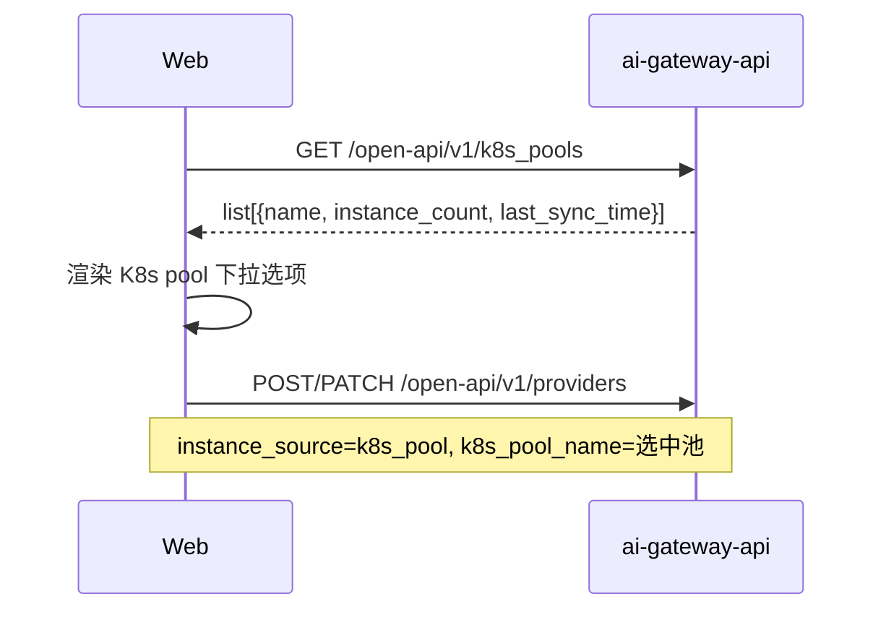
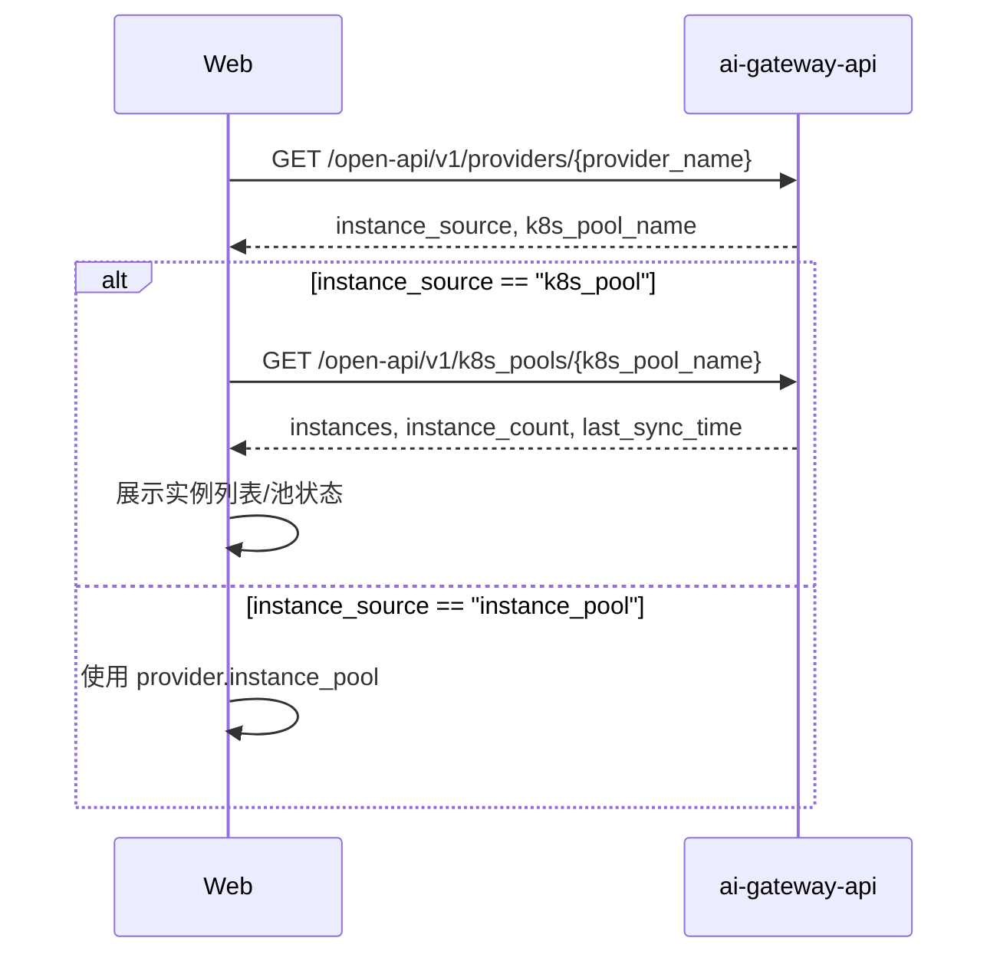

# OpenAPI K8s 实例池只读接口：设计变更说明

> 本文档描述 OpenAPI 暴露 K8s 实例池只读查询的实现设计。接口契约见本目录 `api-changes.md`；摘要见本目录 `change-summary.md`。

## 1. 设计目标与约束

### 1.1 目标

1. 在 OpenAPI 新增两个只读端点：
   - `GET /open-api/v1/k8s_pools`
   - `GET /open-api/v1/k8s_pools/{name}`
2. 读取结果与 InnerAPI `/k8s_pools` 的 GET 完全同源，不引入第二份实例数据。
3. 复用 `ik8s_pool.K8sPoolManager` / `K8sPoolStorager`，不新增模型层和存储层逻辑。
4. 仅提供只读能力，写入/删除仍由 K8s 发现组件通过 InnerAPI 完成。
5. 为 provider 配置和详情页提供稳定的前端调用契约。

### 1.2 约束

- K8s pool 成员唯一写入方是 K8s 发现组件（service-controller），OpenAPI 不能写入。
- 不改变 `providers` / `k8s_pools` 表结构。
- 不改变 InnerAPI `/k8s_pools` 的协议和同步事务语义。
- OpenAPI 路由统一挂载在 `/open-api/v1` 前缀下；`xreq.Endpoint.Path` 只写资源路径。
- 权限模型复用现有 `FeatureK8sPool`，不新增 Feature。

---

## 2. 现状与复用点

### 2.1 InnerAPI 现有实现

| 组件 | 位置 | 复用方式 |
|------|------|----------|
| 读接口 handler | `endpoints/innerapi_v1/k8s_pools/k8s_pools.go` | 参考其 DTO 映射、404/422 处理 |
| pool 管理 | `model/ik8s_pool.K8sPoolManager` | OpenAPI handler 直接调用 `FetchPoolList` / `FetchPool` |
| pool 存储 | `storage/rdb/k8s_pool` | 不改动 |
| 名称校验 | `iprovider.K8sPoolName` | 复用 |
| 权限 Feature | `iauth.FeatureK8sPool` | 复用 `ActionRead` |

### 2.2 现有模型

```go
type K8sPool struct {
    Name       string
    Instances  []iprovider.ProviderInstance
    CreateTime int64
    UpdateTime int64
}
```

- `Instances` 元素为 `iprovider.ProviderInstance`，JSON 字段为 `addr` / `port` / `weight` / `disable`。
- `UpdateTime` 为最近同步时间（Unix 秒），对应 API 的 `last_sync_time`。
- `FetchPoolList` 当前按 `k8s_pools.id` 升序返回全部 pool。
- `FetchPool` 在 pool 不存在时返回 `(nil, nil)`，由 handler 转成 404。

---

## 3. 总体方案

```text
OpenAPI /open-api/v1/k8s_pools
        |
        v
endpoints/openapi_v1/k8s_pools
  ListAction / GetAction
        |
        v
container.K8sPoolManager.FetchPoolList / FetchPool
        |
        v
storage/rdb/k8s_pool -> k8s_pools 表
```

- 仅新增端点层包 `endpoints/openapi_v1/k8s_pools/`。
- 模型层、存储层、数据库均不改动。
- InnerAPI 继续作为 K8s 发现组件的写入通道；OpenAPI 作为控制台只读通道。

---

## 4. 端点层设计

### 4.1 包结构

建议新增：

```text
endpoints/openapi_v1/k8s_pools/
├── endpoints.go   // Endpoints 列表
├── list.go        // GET /k8s_pools
├── one.go         // GET /k8s_pools/{name}
└── data.go        // PoolEntry / PoolListEntry 响应 DTO 与映射
```

### 4.2 响应 DTO

OpenAPI 包定义自己的轻量响应类型，避免 `endpoints/openapi_v1` 反向依赖 `endpoints/innerapi_v1` 的 handler 包：

```go
type PoolEntry struct {
    Name          string                       `json:"name"`
    Instances     []iprovider.ProviderInstance `json:"instances"`
    InstanceCount int                          `json:"instance_count"`
    LastSyncTime  int64                        `json:"last_sync_time"`
}

type PoolListEntry struct {
    Name          string `json:"name"`
    InstanceCount int    `json:"instance_count"`
    LastSyncTime  int64  `json:"last_sync_time"`
}
```

映射：

```go
func poolEntryOf(pool *ik8s_pool.K8sPool) *PoolEntry {
    return &PoolEntry{
        Name:          pool.Name,
        Instances:     pool.Instances,
        InstanceCount: len(pool.Instances),
        LastSyncTime:  pool.UpdateTime,
    }
}
```

`Instances` 直接使用 `iprovider.ProviderInstance`，其 JSON tag 已满足 OpenAPI snake_case 规范；`disable` 作为系统只读字段暴露，与 InnerAPI 实际响应一致。

### 4.3 列表接口

```go
var ListEndpoint = &xreq.Endpoint{
    Path:       "/k8s_pools",
    Method:     http.MethodGet,
    Handler:    xreq.Convert(ListAction),
    Authorizer: iauth.FA(iauth.FeatureK8sPool, iauth.ActionRead),
}

func ListAction(req *http.Request) (interface{}, error) {
    pools, err := container.K8sPoolManager.FetchPoolList(req.Context())
    if err != nil {
        return nil, err
    }
    list := make([]*PoolListEntry, 0, len(pools))
    for _, pool := range pools {
        list = append(list, &PoolListEntry{
            Name:          pool.Name,
            InstanceCount: len(pool.Instances),
            LastSyncTime:  pool.UpdateTime,
        })
    }
    return map[string]interface{}{"list": list}, nil
}
```

行为：

- 不接收 Query 参数。
- 无 pool 时返回 `{"list":[]}`。
- 保持 storage 现有顺序（`id` 升序），与 InnerAPI 一致。

### 4.4 单个 pool 接口

```go
var GetEndpoint = &xreq.Endpoint{
    Path:       "/k8s_pools/{name}",
    Method:     http.MethodGet,
    Handler:    xreq.Convert(GetAction),
    Authorizer: iauth.FA(iauth.FeatureK8sPool, iauth.ActionRead),
}

func GetAction(req *http.Request) (interface{}, error) {
    name := mux.Vars(req)["name"]
    if err := iprovider.K8sPoolName(name); err != nil {
        return nil, err
    }
    pool, err := container.K8sPoolManager.FetchPool(req.Context(), name)
    if err != nil {
        return nil, err
    }
    if pool == nil {
        return nil, xerror.WrapRecordNotExist("k8s pool")
    }
    return poolEntryOf(pool), nil
}
```

行为：

- `name` 非法 -> 422；pool 不存在 -> 404；空池 -> 200 + `instances=[]`。
- 直接读取当前 `k8s_pools` 行，不做缓存。

### 4.5 路由注册

在 `endpoints/openapi_v1/endpoints.go`：

```go
import "github.com/rainway-ai-gateway/ai-gateway-api/endpoints/openapi_v1/k8s_pools"

func endpoints() []*xreq.Endpoint {
    rs := merge(
        ...
        provider.Endpoints,
        k8s_pools.Endpoints,
        ...
    )
    return rs
}
```

OpenAPI router 已统一挂载 `/open-api/v1` 前缀并应用 `McProductProbe` / `McUserProbe`，新增端点无需额外中间件。

---

## 5. 权限设计

- 复用 `iauth.FeatureK8sPool` + `iauth.ActionRead`。
- 当前权限映射：
  - `ScopeSystemAdmin`：`FeatureK8sPool: actionAll`；
  - `ScopeSystemReadonly`：`FeatureK8sPool: actionReadonly`。
- 不新增 Feature、不修改角色映射。
- 说明：`ScopeProduct` 当前没有 `FeatureProvider` / `FeatureK8sPool`，provider 管理本身是系统管理员能力；若未来 provider 管理下放到 product scope，需要同步评估 `FeatureK8sPool` 的 read 授权映射。

---

## 6. 数据一致性与读取语义

1. 读取直接落在 `k8s_pools` 表，反映 K8s 发现组件最近一次 PUT/DELETE 的结果。
2. `last_sync_time` 取 `k8s_pools.updated_at`（`ik8s_pool.K8sPool.UpdateTime`），前端可用于提示数据新鲜度。
3. 列表与详情是两个独立读请求，并发 PUT 时两次响应可能来自不同快照；这是只读查询的正常最终一致行为，不需要跨请求事务。
4. 空池与 pool 不存在严格区分：
   - 空池：200，`instance_count=0`；
   - 不存在：404。
5. 不引入缓存，避免控制台看到过期实例；数据库主键查询成本可控。

---

## 7. 前端使用流程

### 7.1 provider 配置



### 7.2 provider 详情



- provider 详情接口本身不新增实例字段；前端通过 `k8s_pool_name` 查询池详情。
- 若 pool 已被删除，详情接口返回 404，前端应提示 "K8s pool 不存在/已删除"，而不是展示空实例。

---

## 8. 错误处理

| 场景 | 返回 | 处理 |
|------|------|------|
| 未鉴权 | 401 | 标准中间件 |
| 无 `FeatureK8sPool` Read | 402 | 标准授权 |
| IP 白名单拒绝 | 403 | 全局中间件 |
| `name` 不合法 | 422 | `iprovider.K8sPoolName` |
| pool 不存在 | 404 | `xerror.WrapRecordNotExist("k8s pool")` |
| 数据库错误 | 500 | 现有错误包装 |
| 空池 | 200 | `instances=[]`，不是错误 |

---

## 9. 测试设计

### 9.1 单元测试

新增 `endpoints/openapi_v1/k8s_pools/endpoints_test.go`：

- 路由 path/method 正确；
- 列表映射：空列表、单 pool、多 pool、`instance_count`、`last_sync_time`；
- 详情映射：正常、空池、404、非法名称 422；
- 授权配置使用 `FeatureK8sPool` + `ActionRead`。

### 9.2 集成测试

建议新增 `test/integration/tests/k8s_pools/` 或 `test/integration/tests/openapi/k8s_pools/`：

1. 通过 InnerAPI `PUT /inner-api/v1/k8s_pools/{name}/instances` 写入实例；
2. 调用 `GET /open-api/v1/k8s_pools`，断言列表包含该 pool、计数和时间；
3. 调用 `GET /open-api/v1/k8s_pools/{name}`，断言实例字段（含 `weight` 默认值、`disable`）；
4. 空池：PUT `[]` 后详情返回 200 + `instances=[]`；
5. pool 不存在：详情返回 404；
6. 非法名称：详情返回 422；
7. provider 联动：
   - 创建 `instance_source=k8s_pool` 的 provider，`k8s_pool_name` 指向该池；
   - 调用 provider 详情拿到 `k8s_pool_name`；
   - 调用 OpenAPI pool 详情，断言能看到实例；
8. 权限：只读管理员可读；无权限角色返回 402（按现有权限测试基架）。

### 9.3 Schema 契约测试

在 `test/integration/tests/schema/openapi/` 增加：

- `PoolListEntrySchema`：`name` / `instance_count` / `last_sync_time`；
- `PoolEntrySchema`：`name` / `instances` / `instance_count` / `last_sync_time`；
- `instances` 元素 schema：`addr` / `port` / `weight` / `disable`；
- 在 `openapi_schema_test.go` 注册对应用例，锁定字段形状。

---

## 10. 文档更新

1. 新增 `design-docs/api-define/OpenAPI接口定义/k8s-pools.md`：
   - 模块说明、接口清单、两个 GET 的完整定义；
   - 明确只读边界、`FeatureK8sPool` 权限、404/422 语义、`disable` 系统字段。
2. 更新 `design-docs/api-define/OpenAPI接口定义/README.md`，增加 `/k8s_pools` 索引。
3. 更新 `design-docs/api-define/OpenAPI接口定义/providers.md`：
   - 在 k8s 模式响应示例后补充"实例列表可通过 `GET /open-api/v1/k8s_pools/{k8s_pool_name}` 查询"；
   - 不改变 provider 字段契约。
4. 更新 `design-docs/api-define/InnerAPI接口定义/k8s-pools.md`：
   - 将 `disable` 标注为响应中的系统只读字段；
   - 请求 schema 不变，`disable` 不参与写入校验。
5. 更新 `design-docs/sys-design/接口层设计文档.md`：
   - 在 OpenAPI 端点清单中补充 `/k8s_pools` 只读端点；
   - 说明其复用 `ik8s_pool` manager，不新增模型/存储逻辑。
6. `model/存储/数据库` 设计文档无需变更（无模型、表结构、导出变化）。

---

## 11. 兼容、发布与回滚

### 11.1 兼容性

- 纯新增 OpenAPI 端点，向后兼容。
- 不改变 InnerAPI、provider 契约、数据库 schema、BFE 导出。
- 前端未接入时无行为变化。

### 11.2 发布顺序

1. 发布 ai-gateway-api（新增端点 + 文档）。
2. 发布 ai-gateway-web（接入 pool 下拉和 provider 详情实例展示）。
3. 无数据迁移。

### 11.3 回滚

- 回滚 ai-gateway-api 即可移除端点；无数据变更需要清理。
- 若前端已发布但后端回滚，前端需对 404/405 做兼容降级（隐藏 pool 选择/实例展示）。

---

## 12. 备选方案与取舍

| 方案 | 做法 | 结论 |
|------|------|------|
| **A（采纳）** | OpenAPI 新增两个 K8s pool 只读 GET，复用现有 manager | 改动最小、单一数据源、可同时服务 provider 配置和详情；写边界清晰 |
| B | 在 provider 响应中内嵌池实例（例如恢复/扩展 `k8s_instance_pool`） | 拒绝：provider 与 pool 数据重复，容易产生镜像一致性问题；与实时读取相比多一份缓存 |
| C | 直接将 InnerAPI 读接口暴露到 OpenAPI 路径 | 拒绝：InnerAPI 与 OpenAPI 的鉴权、错误码、契约分层不同；直接复用会破坏边界 |
| D | OpenAPI 同时开放 pool 的 PUT/DELETE | 拒绝：违反"发现组件是唯一写入方"的 ownership 边界 |
| E | 列表加分页 | 暂缓：provider 下拉需要全量；当前池数量有限，后续可兼容扩展 |

---

## 13. 不改动项

- `model/ik8s_pool`、`storage/rdb/k8s_pool`、`ik8s_pool.K8sPoolManager`：不改。
- `providers` 表、`k8s_pools` 表：不改。
- InnerAPI `/k8s_pools` 的 PUT/GET/DELETE：不改。
- provider 的请求/响应结构：不改。
- BFE / conf-agent / EPP 导出：不改。
- `FeatureK8sPool` 角色映射：不改。