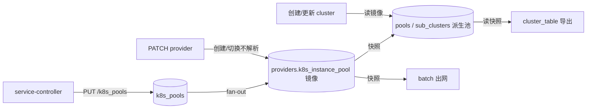
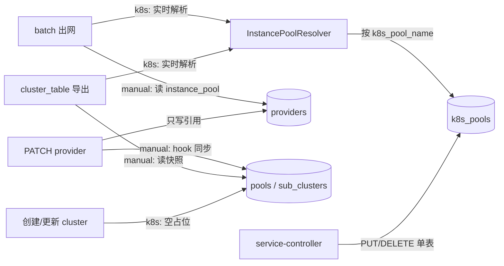

# k8s_pool 实时解析改造（方案 B）：设计变更说明

> 本文档描述"删除实例镜像与 fan-out、消费点实时解析"的实现设计。接口契约见本目录 `api-changes.md`；摘要见本目录 `change-summary.md`。

## 1. 设计目标与约束

### 1.1 目标

1. `k8s_pools` 成为 k8s 来源实例的唯一事实源；provider 只保存 `instance_source` / `k8s_pool_name` 引用。
2. 所有消费点（cluster_table 导出、batch 出网、cluster 创建/更新）按 `k8s_pool_name` 实时解析。
3. cluster 派生池在 k8s 模式下退化为 schema 占位行（存在但实例为空）。
4. 彻底删除 `providers.k8s_instance_pool` 镜像与 fan-out 写链。
5. 手工来源（`instance_pool`）链路一行不动。

### 1.2 约束

- 手工来源的所有读写路径与改造前完全一致。
- `/k8s_pools` InnerAPI 路径、鉴权、请求/响应结构不变。
- BFE `cluster_table` 格式与空条目语义不变；版本号由导出结果 MD5 签名自动 bump。
- 不引入跨请求 TTL 缓存（避免重新引入一致性窗口）。
- `cluster_table` 生成内所有读取在同一事务上下文（`ExportConfig`），各表看到同一快照。

## 2. 两类实例来源的职责划分

| 维度 | `instance_pool`（手工来源） | `k8s_pool`（K8s 来源） |
|---|---|---|
| provider 字段 | `instance_pool` | `k8s_pool_name`（`instance_pool` 休眠保留） |
| 事实源 | `providers.instance_pool` | `k8s_pools.instances` |
| 写入方 | 运营通过 OpenAPI 写 provider | service-controller 通过 InnerAPI 全量替换 |
| provider 更新时 | 写自身字段 + 同步引用 cluster 的派生池 | 只改引用，不写任何实例数据 |
| cluster 创建时 | 从 `instance_pool` 生成派生池快照 | 生成**空派生池占位行** |
| cluster 更新时 | 从 `instance_pool` 刷新派生池快照 | 不改写实例数据（占位行保持为空） |
| `cluster_table` 导出 | 直读派生池快照 | 按 `k8s_pool_name` 实时查 `k8s_pools` |
| batch 出网 | 读 `instance_pool` | 实时查 `k8s_pools` |
| OpenAPI 实例展示 | 读 `instance_pool` | 走 #290 `GET /open-api/v1/k8s_pools/{name}` |
| EPP 指派 | 不涉及 | 不涉及（EPP 读自己的 `epp_pool` 存储） |

## 3. 不变量（Review 重点）

| 编号 | 不变量 |
|---|---|
| I1 | `k8s_pools` 是 k8s 来源实例的唯一事实源；不存在第二份实例镜像 |
| I2 | k8s 模式下 `providers.instance_pool` 是休眠字段，不参与任何有效池计算 |
| I3 | k8s 模式下 cluster 派生池行必须存在，但实例列表必须为空（占位）；新建/切换路径必须保证，存量行由可选清理修复 |
| I4 | `k8s_pool_name` 为空 / pool 不存在 / pool 为空 ⇒ 有效池为空列表，不报错 |
| I5 | `k8s_pools` 读取失败 ⇒ 依赖该次导出的请求失败（fail-close），不静默回退旧快照 |
| I6 | 手工来源的所有读写路径与改造前完全一致 |
| I7 | `/k8s_pools` 的 PUT/DELETE 不写 `providers` / `clusters` / `pools` / `sub_clusters` 任何表 |
| I8 | provider PATCH（k8s 模式）不写 cluster 派生池的实例数据；仅在模式切换清理旧快照时写入空列表 |

## 4. 总体架构

### 4.1 改造前



问题：`k8s_pools` 与派生池之间存在两个写跳（镜像 + fan-out），任一跳漏写都会导致数据面为空。

### 4.2 改造后



### 4.3 依赖方向

```text
model/iprovider
  ├── K8sPoolInstanceReader        (interface)
  ├── InstancePoolResolver         (纯逻辑，注入 reader)
  └── 不 import model/ik8s_pool / model/icluster_conf

model/ik8s_pool
  ├── import model/iprovider
  ├── K8sPoolStorager 内嵌 K8sPoolInstanceReader
  └── 不再 import model/icluster_conf

storage/rdb/k8s_pool
  ├── import model/ik8s_pool + model/iprovider
  └── 实现 FetchK8sPoolInstances

model/icluster_conf
  ├── import model/iprovider
  └── 注入 InstancePoolResolver（exporter / cluster create/update）
```

该方向消除了 `ik8s_pool -> icluster_conf` 依赖，避免循环，也让"k8s 池域不反向写 cluster 域"在编译期成立。

### 4.4 一致性与版本

- 一次 `cluster_table` 导出内的所有读取都发生在 `ExportConfig` 的同一个事务上下文，cluster / provider / k8s_pools 看到同一快照；
- 生成结果计算 MD5 签名，实例变化 ⇒ 签名变化 ⇒ 版本自动 bump，BFE 下次拉取即更新；
- 不需要 fan-out 承担"版本及时性"。

### 4.5 失败策略

| 场景 | 策略 |
|---|---|
| `FetchClusterList` 失败 | fail-close：整个导出报错 |
| `FetchProviderList` 失败 | fail-close |
| `k8s_pools` 读取失败 | fail-close：整个导出报错，BFE 保持上一版本 |
| provider 不存在（脏数据） | 回退该 cluster 的派生池快照，并记录 warning |
| `k8s_pool_name` 为空 | 空列表（不报错） |
| pool 不存在 | 空列表（不报错） |
| resolver 未注入 | 返回明确错误（不静默空池） |

选择 fail-close 的理由：数据面拿到陈旧实例比"导出不更新"更危险；BFE 会继续使用最后一个成功版本，不会直接中断转发。

## 5. 详细设计

### 5.1 `iprovider.InstancePoolResolver`

```go
// K8sPoolInstanceReader 由 k8s_pool storage 实现。
type K8sPoolInstanceReader interface {
    FetchK8sPoolInstances(ctx context.Context, poolName string) ([]ProviderInstance, error)
}

type InstancePoolResolver struct {
    reader K8sPoolInstanceReader
}

func NewInstancePoolResolver(reader K8sPoolInstanceReader) *InstancePoolResolver {
    return &InstancePoolResolver{reader: reader}
}

func (r *InstancePoolResolver) Effective(ctx context.Context, p *Provider) ([]ProviderInstance, error) {
    if p == nil {
        return nil, nil
    }
    if p.InstanceSource != InstanceSourceK8sPool {
        return p.InstancePool, nil
    }
    if p.K8sPoolName == nil || *p.K8sPoolName == "" {
        return []ProviderInstance{}, nil
    }
    if r == nil || r.reader == nil {
        return nil, ErrInstancePoolResolverNotConfigured
    }
    return r.reader.FetchK8sPoolInstances(ctx, *p.K8sPoolName)
}
```

| 输入 | 输出 |
|---|---|
| `p == nil` | `nil, nil` |
| 手工来源 | `p.InstancePool` |
| k8s + 空池名 | 非 nil 空列表 |
| k8s + 池存在 | 池实例列表 |
| k8s + 池不存在 | 非 nil 空列表 |
| reader DB 错误 | `nil, err` |
| resolver 未注入 | 明确错误（`ErrInstancePoolResolverNotConfigured`） |

注意：返回值统一为"非 nil 空列表"是刻意的，避免下游把 `nil` 当成"未提供"而跳过清空。

缓存策略：resolver 本身不做缓存；导出器在一次生成内按 `k8s_pool_name` 做请求级缓存；batch 每次出网只查一次；不引入跨请求 TTL 缓存。

### 5.2 存储层读取实现

`storage/rdb/k8s_pool/k8s_pool.go` 增加：

```go
func (s *RDBK8sPoolStorager) FetchK8sPoolInstances(ctx context.Context,
    name string) ([]iprovider.ProviderInstance, error) {

    pool, err := s.FetchPool(ctx, name)
    if err != nil {
        return nil, err
    }
    if pool == nil {
        return []iprovider.ProviderInstance{}, nil
    }
    return pool.Instances, nil
}
```

`model/ik8s_pool.K8sPoolStorager` 内嵌 `iprovider.K8sPoolInstanceReader`。

### 5.3 Provider 域改造

**删除镜像字段**：删除 `iprovider.Provider.K8sInstancePool`、`iprovider.ProviderParam.K8sInstancePool`、`dao.TProvider.K8sInstancePool` 及所有 marshal/unmarshal 分支、`applyProviderUpdate` 中的镜像赋值、`EffectiveInstancePool`（所有调用点改用 resolver 或 `InstancePool`）。

**`CreateProvider`**：保持校验 `instance_source` 与 `k8s_pool_name`；允许引用不存在的 pool（零实例语义）；不写任何实例镜像；创建时不解析 `k8s_pools`（创建后没有任何 cluster 引用它，导出按需解析）。

**`UpdateProvider` hook 触发条件**：按来源判断，不再用有效池比较：

```go
if origInstanceSource != nil && *origInstanceSource != existing.InstanceSource {
    // 模式切换必须触发：manual -> k8s 需要清空旧快照；k8s -> manual 需要写入新快照
    clusterConfigChanged = true
}
if origInstancePool != nil &&
    existing.InstanceSource == InstanceSourceInstancePool &&
    !providerInstancePoolEqual(existing.InstancePool, origInstancePool) {
    // 手工来源的实例变更必须同步派生池
    clusterConfigChanged = true
}
```

- k8s 模式下 PATCH `instance_pool`（休眠字段）不触发任何同步；
- k8s 模式下只改 `k8s_pool_name`（A→B）不需要同步派生池（占位行始终为空，导出实时读 B）；
- 手工模式的比较与原有语义一致。

**`ProviderInstancePoolSyncer`**：保留 hook 名称，语义调整为：

```go
func (cm *ClusterManager) ProviderInstancePoolSyncer(ctx context.Context,
    oldProvider, newProvider *iprovider.Provider) error {

    if newProvider == nil {
        return nil
    }
    // k8s 来源：派生池只允许是空占位。
    if newProvider.InstanceSource == iprovider.InstanceSourceK8sPool {
        if oldProvider != nil && oldProvider.InstanceSource == iprovider.InstanceSourceK8sPool {
            return nil // k8s -> k8s（含池名切换）：占位不变，无需写
        }
        // manual -> k8s：清理旧的手工快照，维持占位不变量
        return cm.SyncProviderInstances(ctx, newProvider.Name, nil)
    }
    // 手工来源：同步 instance_pool 快照
    if oldProvider != nil &&
        oldProvider.InstanceSource == iprovider.InstanceSourceInstancePool &&
        providerInstancePoolEqual(oldProvider.InstancePool, newProvider.InstancePool) {
        return nil
    }
    return cm.SyncProviderInstances(ctx, newProvider.Name, newProvider.InstancePool)
}
```

写入的只有"手工实例"或"空列表"，**绝不写 k8s 实例**，因此不属于被删除的 fan-out。

**请求体中的 `k8s_instance_pool`**：字段连同 DDL 一起彻底删除，请求携带时 `BindJSON` 按未知字段静默忽略。

**Provider 响应**：`GET /open-api/v1/providers/{name}` 移除 `k8s_instance_pool` 字段。web 已通过 #290 `GET /open-api/v1/k8s_pools/{name}` 展示实时实例，无需改代码，需要回归验证。

### 5.4 Cluster 域改造

**`CreateCluster`**：按来源分流：

```go
var poolInstances []Instance // icluster_conf 包内类型
if provider.InstanceSource == iprovider.InstanceSourceK8sPool {
    // k8s 来源：派生池仅作 subcluster -> pool 的 schema 占位，
    // 实例由导出/cluster_table 实时解析。
    poolInstances = providerInstancesToClusterInstances(nil)
} else {
    poolInstances = providerInstancesToClusterInstances(provider.InstancePool)
}
```

`providerInstancesToClusterInstances(nil)` 返回非 nil 空切片，确保 `pools.instance_detail` 写成 `"[]"` 而不是 NULL。

**`UpdateCluster`**：

```go
if provider.InstanceSource == iprovider.InstanceSourceK8sPool {
    if providerChanged {
        // 维持占位不变量：清理可能残留的手工/旧快照
        for _, sc := range oldData.SubClusters {
            if sc.InstancePool == nil {
                continue
            }
            if err := cm.poolStorager.UpdatePool(ctx, sc.InstancePool, &PoolParam{
                Instances: providerInstancesToClusterInstances(nil),
            }); err != nil {
                return err
            }
        }
    }
    // provider 未变化：占位已为空，不写
} else if providerChanged || providerUnchangedButReferenced {
    // 手工来源：保持原有逻辑
    ...
}
```

同时修复了原实现在 k8s 模式下用休眠字段 `provider.InstancePool` 误清空/写错派生池的问题。

**`SyncProviderEffectivePool` → `SyncProviderInstances`**：删除前者，新增统一的写函数，职责为查找所有 `llm_config.provider == providerName` 的 cluster，把其所有非空 `InstancePool` 写成 `instances`（空列表也写，用于清空）。只服务两类调用：手工来源的 provider 实例变更；manual → k8s 模式切换时清空旧快照。

**不新增启动 backfill**：k8s 来源的派生池快照不再有消费方，backfill 无数据可修。

**生命周期兼容性核对结论**（基线 `899b107`）：

1. 占位池与 schema/校验完全兼容：`pools.ready` 默认 1，绑定校验通过；exporter 空实例跳过 → 空条目 `{}` 与现状语义一致；DeleteCluster 级联删除对空占位池成立，重建无冲突。
2. 换 provider 的旧实例残留必须接住：manual → k8s 的来源切换可经 provider PATCH 完成、不经 UpdateCluster；hook 增强（manual→k8s 时清空）与一次性迁移不是可选项。
3. 派生池消费者语义变化：`isDomainPool` 对占位池恒 false——k8s 发现写的是 Pod IP 行为正确；若 k8s pool 写域名实例，健康检查/Host 头行为与改造前不同（已知限制）；product_pool/pool API 在 k8s 模式下永远显示空实例，排障须看 `/k8s_pools`（#290）。
4. EPP 路径不受影响：指派走 `epp_pool` 独立存储；BFE 本地兜底读 `cluster_table`（实时导出后正确）。
5. 额外收益：cluster 层写竞争自然消除——`UpdateCluster` 写派生池与 pool PUT 的 fan-out 交错改写同一 pool 行的竞态随 fan-out 删除而消失。

### 5.5 `ik8s_pool` 域改造

**构造函数**：删除 `clusterManager` 依赖：

```go
func NewK8sPoolManager(
    txn itxn.TxnStorager,
    storager K8sPoolStorager,
    providerStorager iprovider.ProviderStorager,
) *K8sPoolManager
```

**`ReplaceInstances`**：单表单写；返回结构与 `last_sync_time` 语义不变；不再写 provider，也不再写 cluster。

**`DeletePool`**：保留"被引用则清空保留、无引用则删行"的外部语义：

```text
查询 k8s_pools 行（不存在 -> 404）
查询引用该 pool 的 provider（instance_source=k8s_pool && k8s_pool_name=name）
  ├── 无引用：删除 k8s_pools 行
  └── 有引用：warning 日志 + 把 instances 清空并保留行
```

两者在同一事务内完成；对 provider 表只读不写。不简化成"DELETE 永远删行"的理由：现有契约区分"pool 不存在（404）"与"pool 存在但为空（200 + []）"；保留行可保留 `last_sync_time` 便于排障；对消费者而言两种语义都等价于零实例（I4）。

**删除 `syncProviderMirrors`** 及其对 `ClusterManager` 的依赖。

### 5.6 `cluster_table` 导出改造（核心）

新算法要点（`model/icluster_conf/exporter.go`）：

1. **provider 只查一次**：`FetchProviderList(nil)` 返回全量，建 `map[name]*Provider` 避免 N+1。
2. **pool 只查一次**：同一 provider 被多个 cluster 引用时，用请求级 `poolCache` 按 `k8s_pool_name` 去重。
3. **手工路径不变**：`instances = subCluster.InstancePool.Instances`，遍历顺序、IPv6 处理、空实例跳过都保持一致。
4. **provider 缺失回退**：`provider == nil` 时走手工快照路径，兼容无 provider 的存量 cluster 和脏数据。
5. **空池语义不变**：k8s 池为空/不存在 ⇒ 跳过该 subcluster ⇒ cluster 以空条目导出，`BK_NO_BACKEND` 语义不变。
6. **版本自动 bump**：生成结果变化由 `Sign` 检测，无需额外改 `ExportClusterTable`。
7. **不在导出层写库**：整个生成器只读。

k8s 实例应用到该 cluster 的所有 subcluster，与现有 `SyncProviderEffectivePool` 语义一致（保持现状，非新增行为）。

**AIConf 导出的 `isDomainPool`**：去除 k8s 快照后，k8s 发现组件写入的是 Pod IP，`isDomainPool` 返回 false，行为正确；如果未来允许 k8s pool 写域名，需要让 `isDomainPool` 走 resolver。本期列为已知限制，不扩大改动面。

### 5.7 Batch 出网

`model/ibatch` 的选实例逻辑改用 resolver：

```go
func (m *Manager) pickProviderInstance(ctx context.Context,
    provider *iprovider.Provider) (*iprovider.ProviderInstance, error) {

    instances, err := m.instancePoolResolver.Effective(ctx, provider)
    if err != nil {
        return nil, xerror.WrapModelError(err)
    }
    for _, inst := range instances {
        if inst.Disable || inst.Addr == "" || inst.Port <= 0 {
            continue
        }
        return &inst, nil
    }
    return nil, nil
}
```

`Manager` 增加 `instancePoolResolver` 字段与 `SetInstancePoolResolver` 方法；容器在 `initBatch` 中注入。

### 5.8 容器装配

`stateful/container/rdb/components.go`：

```go
container.InstancePoolResolver = iprovider.NewInstancePoolResolver(container.K8sPoolStorager)
// ProviderManager 不需要 resolver：hook 触发只比较 instance_source / instance_pool。
container.ClusterManager.SetInstancePoolResolver(container.InstancePoolResolver)
// NewK8sPoolManager 去掉 ClusterManager 实参。
manager.SetInstancePoolResolver(container.InstancePoolResolver) // initBatch
```

`stateful/container/components.go` 增加 `InstancePoolResolver *iprovider.InstancePoolResolver` 单例。

### 5.9 数据库与迁移

| 文件 | 改动 |
|---|---|
| `db_ddl.sql` | 删除 `k8s_instance_pool` 列定义 |
| `db_ddl_sqlite.sql` | 删除 `k8s_instance_pool` 列定义 |
| `database/db_ddl_upgrade_to_0.0.11.sql` | 删除 `ADD COLUMN`（该列不发布） |
| `output/database/db_ddl_upgrade_to_0.0.11.sql` | 保留/更新"未发布 + 手动 DROP"说明 |
| 预览库（若已建列） | `ALTER TABLE providers DROP COLUMN k8s_instance_pool;` |

SQLite 3.35+ 支持 `DROP COLUMN`；旧版本用"建新表 + 数据搬迁"或重建库（集成测试使用内存库，不受影响）。

DDL 推迟到 P3 的理由：P2 代码已不依赖该列，保留列可以让 P2 回滚到 P1 时无需改库；等 P2 稳定一个发布周期后再 DROP，风险最低。

一次性清理（可选，非必须）：去掉 fan-out 后，存量 k8s cluster 的派生池实例成为无人消费的旧数据。若希望控制台 `product_pool` 视图也保持"空占位"，可执行：

```sql
UPDATE pools p
JOIN sub_clusters sc ON sc.bns_name_id = p.id
JOIN clusters c ON c.id = sc.cluster_id
JOIN providers pr ON pr.name = JSON_UNQUOTE(JSON_EXTRACT(c.llm_config, '$.provider'))
SET p.instance_detail = '[]'
WHERE pr.instance_source = 'k8s_pool';
```

该 SQL 只清理展示数据，不影响导出正确性；建议在维护窗口执行并先备份。

### 5.10 Web / Controller 影响

- **web**：`ProviderView.vue` 已按 `k8s_pool_name` 调 #290 接口展示实时实例；`ProviderUpsert.vue` 提交时不带 `k8s_instance_pool`。理论上零代码改动，需要回归验证。
- **controller**：`EnsureK8sPool` 继续全量 PUT；修复后不再依赖"第二次 PUT 补镜像"，无需改动。
- **BFE**：只消费 `cluster_table`，格式不变；版本 bump 由签名接管。

## 6. 行为矩阵（改造前 vs 改造后）

| # | 场景 | 改造前 | 改造后 |
|---|---|---|---|
| 1 | PUT pool → 创建 provider → 创建 cluster → 不再次 PUT | cluster_table 为空（本次 bug） | cluster_table 立即有实例 |
| 2 | 创建 provider → 创建 cluster（空）→ PUT pool | fan-out 写镜像和派生池 | 导出实时解析，有实例（不写派生池） |
| 3 | PUT pool 增删实例 | fan-out 更新派生池 | 下一次导出立即反映 |
| 4 | PATCH provider：`instance_pool -> k8s_pool` | 用空镜像清空派生池 | 清空派生池占位；导出实时读 k8s pool |
| 5 | PATCH provider：`k8s_pool_name A -> B` | 不触发 hook；导出仍读 A 的镜像 | 导出实时读 B |
| 6 | PATCH cluster（k8s provider） | 用休眠 `instance_pool` 写派生池 | 不写实例数据；导出不受影响 |
| 7 | DELETE 被引用 pool | 清空镜像 + fan-out 清空派生池 | 清空 `k8s_pools` 行并保留；导出为空 |
| 8 | DELETE 未被引用 pool | 删行 + 空 fan-out | 删行；导出无影响 |
| 9 | provider 引用不存在的 pool | 镜像可能为空/陈旧 | 导出为空条目（零实例） |
| 10 | `k8s_pools` 读失败 | 导出可能仍用旧快照成功 | 导出 fail-close，BFE 保持上一版本 |
| 11 | 手工 provider 全链路 | 快照 | 完全不变 |
| 12 | batch 出网（k8s provider） | 读镜像（同样可能为空） | 实时解析，修复同类问题 |
| 13 | EPP 指派/兜底 | 指派读 epp_pool；兜底读 cluster_table | 指派不变；兜底跟随实时导出 |

## 7. 代码改动清单

| 文件 | 改动 | 预估 |
|---|---|---|
| `model/iprovider/provider.go` | 新增 reader/resolver；删除镜像字段、`EffectiveInstancePool`；调整 Update hook 触发 | +70 / -60 |
| `model/iprovider/instance_pool_resolver_test.go`（新增） | resolver 语义单测 | +120 |
| `model/icluster_conf/cluster.go` | 删除 `SyncProviderEffectivePool`；新增 `SyncProviderInstances`；Create/Update 分流；hook 语义调整 | +60 / -110 |
| `model/icluster_conf/exporter.go` | cluster_table 实时解析 + provider map + pool cache | +80 / -20 |
| `model/icluster_conf/exporter_test.go` | k8s/manual/错误/回退/多 cluster 去重用例 | +200 / -30 |
| `model/ik8s_pool/k8s_pool.go` | 删除 cluster 依赖与 `syncProviderMirrors`；Replace/Delete 单表化 | -80 |
| `model/ik8s_pool/k8s_pool_test.go` | 删除 fan-out 断言，补删/清空语义 | -60 / +40 |
| `model/ibatch/cancel.go` + `manager.go` | resolver 注入；`pickProviderInstance` 返回 error | +30 / -10 |
| `storage/rdb/provider/provider.go` | 删除镜像 marshal/unmarshal | -30 |
| `storage/rdb/internal/dao/table_providers.go` | 删除镜像列字段 | -2 |
| `storage/rdb/k8s_pool/k8s_pool.go` | 新增 `FetchK8sPoolInstances` | +15 |
| `stateful/container/rdb/components.go` | resolver 装配；K8sPoolManager 签名；batch 注入 | +15 / -10 |
| `stateful/container/components.go` | 新增 resolver 单例 | +2 |
| `endpoints/openapi_v1/provider/create.go` / `update.go` | （旧 422 拒绝已随字段删除一并移除） | -10 |
| `db_ddl.sql` / `db_ddl_sqlite.sql` / `database/db_ddl_upgrade_to_0.0.11.sql` | 删除镜像列（P3） | -3 |
| 其它单测（provider/cluster/storage/endpoints） | 跟随字段与签名变化 | 约 -150 / +150 |

核心代码估算：**净减少约 200 行**；测试改动量大于代码本身。

## 8. 实施顺序与发布策略

同一设计、三阶段分批提交：

### P1：实时读路径（先修复问题，保留旧写链路）

1. 新增 `K8sPoolInstanceReader` / `InstancePoolResolver` 与 storage 实现；
2. `cluster_table` 导出改为实时解析；
3. batch 改用 resolver；
4. `CreateCluster` / `UpdateCluster` 改用分流（手工走 `instance_pool`，k8s 走实时/空占位）；
5. 容器装配；
6. 保留镜像、fan-out、hook 原样（此时它们变成冗余但无害）。

效果：本次 bug 立即修复；手工来源不受影响；回滚只需 revert P1；旧代码仍可读取镜像，发布窗口内滚动兼容。

### P2：删除写链路

1. 删除 `providers.k8s_instance_pool` 字段与 DAO（代码层）；
2. 删除 `EffectiveInstancePool`；
3. 删除 fan-out / `syncProviderMirrors` / `SyncProviderEffectivePool`；
4. `ik8s_pool` 单表化，构造签名调整；
5. hook 收缩为"手工同步 + manual→k8s 清空占位"；
6. `CreateCluster` k8s 建空占位；`UpdateCluster` k8s 不写实例；
7. 删除相关单测/集成测试断言，新增占位语义测试。

效果：单一事实源、无 fan-out、派生池在 k8s 模式下为空占位；数据库列暂时保留（不读不写），便于回滚。

### P3：DDL 与文档收尾

1. 从 `db_ddl.sql` / `db_ddl_sqlite.sql` / 升级脚本删除 `k8s_instance_pool`；
2. 预览库手动 DROP；
3. 更新 API/系统设计文档、CHANGELOG；
4. 可选：执行一次性派生池清理。

### 滚动发布兼容性

| 阶段 | 旧实例行为 | 新实例行为 | 兼容性 |
|---|---|---|---|
| P1 滚动中 | 读镜像、fan-out | 实时解析，仍保留镜像写 | 兼容；导出结果一致或更新 |
| P2 滚动中 | 读镜像 + fan-out | 实时解析，不写镜像 | 旧实例可能短暂用旧镜像导出；新实例导出正确；不写坏数据 |
| P3 | 不再有旧实例 | 不依赖列 | 要求 P2 全量完成 |

建议 P2 在低峰发布；P3 前确认没有回滚需求。

### 回滚

| 回滚点 | 操作 | 数据影响 |
|---|---|---|
| P1 | git revert | 无 |
| P2 | 回滚代码到 P1；列仍在 | 镜像可能陈旧；下一次 pool PUT 由旧 fan-out 重建 |
| P3 后 | 重新加列 + 回滚代码 | 镜像丢失，但下一次 pool PUT 会重建；需备份 |

## 9. 测试计划

### 9.1 单元测试

**resolver**：手工来源返回 `instance_pool`；k8s 来源按名称读取 reader；空 `k8s_pool_name` 返回非 nil 空列表；pool 不存在返回非 nil 空列表；reader 错误向上传播；resolver 未注入返回明确错误；`p == nil` 返回 `nil, nil`。

**provider**：创建不写镜像；手工 PATCH `instance_pool` 触发 hook；manual→k8s 触发清空；k8s→manual 触发写入；k8s→k8s 改池名不同步；k8s 模式 PATCH 休眠 `instance_pool` 不同步；请求携带 `k8s_instance_pool` 按未知字段静默忽略。

**cluster**：`CreateCluster` 手工来源 → 派生池等于 `instance_pool`；k8s 来源 → 派生池存在且实例为空；`UpdateCluster` 手工来源快照刷新；k8s 来源且 provider 变化 → 派生池被清空；provider 未变 → 不写 pool；`SyncProviderInstances` 覆盖所有引用 cluster；`ProviderInstancePoolSyncer` 四种来源组合。

**exporter**：k8s cluster 实时解析；手工 cluster 快照不变；无 provider 回退快照；空池/缺池空条目；resolver 错误导出失败；多 cluster 共享同一 pool 只查一次；IPv6 格式 `[addr]_port`；版本签名随实例变化。

**ik8s_pool**：`ReplaceInstances` 只写 `k8s_pools`（mock 断言零跨表调用）；`DeletePool` 无引用删行、有引用保留行 + 空实例 + warning；构造函数不再需要 ClusterManager。

**storage**：provider 读写不再包含 `k8s_instance_pool`；`FetchK8sPoolInstances` 存在/不存在/空池/DB 错误/实时性。

**batch**：k8s provider 选到实时实例；手工 provider 选到 `instance_pool`；resolver 错误向上传播；无实例返回 `errProviderUnavailable`。

### 9.2 集成测试（重点）

1. **本次 bug 回归（必须）**：PUT pool（4 实例）→ 创建 provider（k8s 模式）→ 创建 cluster → **不再次 PUT** → `cluster_table` 立即包含 4 个 backend。
2. **顺序反转**：创建 provider → 创建 cluster（空）→ PUT pool → `cluster_table` 跟随出现实例。
3. **cluster PATCH 不清空**：k8s provider + 非空 pool → PATCH cluster → 导出仍有实例。
4. **provider 模式切换**：`instance_pool -> k8s_pool` 导出自 k8s pool；`k8s_pool -> instance_pool` 导出自手工池。
5. **池增删**：PUT 增加/删除实例 → 导出跟随。
6. **DELETE pool**：无引用 GET 404；有引用 GET 200 + `instance_count=0`、导出空条目。
7. **空池/缺池**：provider 引用不存在的 pool → 导出空条目，不报错。
8. **版本 bump**：PUT pool 前后 `cluster_table` 的 `Version` 必须变化。
9. **契约**：provider 响应不含 `k8s_instance_pool`；请求携带被静默忽略；`k8s_pools` schema 不变。
10. **手工来源回归**：手工 provider/cluster 全链路不变。

### 9.3 验收命令

```bash
make test-model
make test-model-cover-gate
make test
make license-check

cd test/integration
go test ./tests/provider/...
go test ./tests/k8s_pools/...
go test ./tests/clusters/...
go test ./tests/innerapi/...
```

## 10. 风险与缓解

| 风险 | 等级 | 缓解 |
|---|---|---|
| 导出新增 `k8s_pools` 读依赖，DB 故障导致导出失败 | 低 | fail-close + 告警；BFE 持最后成功版本；同库单表故障概率低 |
| 手工来源被误伤 | 中 | 代码按来源显式分流；专项回归用例锁住 |
| resolver 未注入导致空池 | 中 | 返回明确错误而非空列表；容器装配测试 |
| k8s 模式派生池为空被误读为 bug | 中 | 代码注释 + 文档 + 测试明确"占位"语义 |
| 导出 N+1 | 低 | provider 全量一次；pool 请求级缓存 |
| 版本 bump 风暴 | 低 | 与现有 fan-out 频率一致；签名机制就是为此设计 |
| `isDomainPool` 对 k8s 域名实例失效 | 低 | k8s 发现组件只写 Pod IP；文档标注限制 |
| 多 subcluster 的 provider cluster 被统一写入 | 低 | 保持现有 fan-out 语义；后续如支持需引入 subcluster 级来源 |
| P2/P3 回滚需要恢复列 | 低 | P2 保留列；P3 延后一个发布周期 |

## 11. 备选方案与取舍

| 方案 | 内容 | 结论 |
|------|------|------|
| **B（采纳）** | 删除镜像；k8s 来源所有消费点实时解析；删除 fan-out | 单一事实源；无一致性窗口；彻底消除"镜像空洞"；手工来源零影响 |
| A | provider 创建/更新时读 `k8s_pools` 填镜像，并补 hook | 仍保留镜像与 fan-out，一致性窗口和"漏同步"类 bug 面仍在；后续还要再改一次 |
| C | controller 周期 PUT pool 或 api 周期 reconcile | 治标不治本；仍有窗口；依赖外部组件；无法覆盖 provider/池名切换 |

## 12. 验收标准

1. 先 PUT pool（4 实例）→ 创建 provider → 创建 cluster → **不再 PUT** → `cluster_table` 中该 cluster 包含 4 个 backend。
2. 修改 cluster 不会清空 k8s 实例的导出结果。
3. PUT/DELETE pool 后，下一次 `cluster_table` 导出立即反映最新实例，且 `Version` 变化。
4. provider 响应不再包含 `k8s_instance_pool`；请求携带该字段被静默忽略。
5. `providers` 表不再有 `k8s_instance_pool` 列。
6. k8s 模式下 cluster 派生池实例列表为空（占位），且不影响导出。
7. 手工 provider/cluster 全链路行为与改造前一致。
8. batch 对 k8s provider 能选到 `k8s_pools` 中的实时实例。
9. `k8s_pools` 读失败时导出失败、BFE 保持上一版本，不产生空配置。
10. 单测/集成测试全部通过，model 覆盖率不低于门槛。
